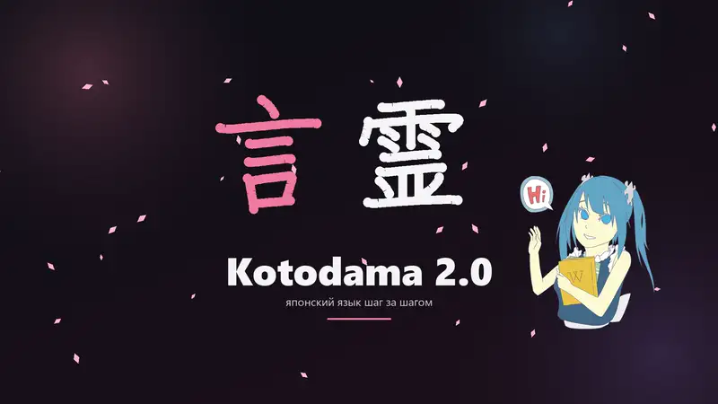

# Kotodama · 言霊

**Приложение для изучения японского с нуля** — для Windows и Linux, на русском языке.
*Котодама* — «душа слова»: в японской традиции правильно произнесённое слово обретает силу.


### 🎬 Видео-обзор Kotodama 2.0

[](https://disconnected-cloud.github.io/kotodama-japanese/)

**[▶ Смотреть полное видео со звуком](https://disconnected-cloud.github.io/kotodama-japanese/)** (40 секунд, 1080p, 60 к/с)

## Что внутри

- **«Учиться» — одна кнопка** — приложение само собирает занятие на 5, 15 или 30 минут: повторение, ошибки, новое по пути, аудирование, речь.
- **Путь обучения** — 36 юнитов от каны до N2: сначала теория, потом практика по шагам.
- **Кана, слова, кандзи** — уровни N5–N2, около 2 600 слов с примерами фраз, 480 кандзи с анимацией порядка черт, разбором на части и подсказками для запоминания, интервальные повторения по алгоритму **FSRS**.
- **Питч-акцент** — линии высокого и низкого тона у 70 000 слов (например, 箸 / 橋 / 端 — «палочки», «мост», «край»).
- **Тест уровня при первом запуске** — не нужно начинать с азбуки, если ты её уже знаешь.
- **Грамматика** — 65 уроков N5–N2 (включая кэйго) с объяснениями, озвученными примерами и упражнениями.
- **Говорение** — повторяешь за носителем, а приложение оценивает произношение по трём параметрам: звуки (распознавание Whisper, сравнение по звучанию, а не по написанию), интонация (график мелодии голоса) и ритм. Ошибки подсвечиваются прямо в фразе по слогам — нажми на слог, чтобы переслушать только его. Шумоподавление перед распознаванием.
- **Минимальные пары** — おばさん/おばあさん, きて/きって, かき/かぎ: сначала учишься слышать разницу, потом произносить. Плюс урок «Мои слова вслух» из твоих карточек.
- **Диалоги по ролям** — собеседник говорит, ты отвечаешь вслух.
- **Слово дня** — уведомление с озвучкой в выбранное время; значок с числом карточек к повторению.
- **Чтение** — японская классика в оригинале (Акутагава, Сосэки, Миядзава, Ниими Нанкити, хайку) и учебные повести: фуригана, озвучка, перевод и словарь по клику.
- **Словарь** — 219 000 статей JMdict: 69 000 с русским переводом, остальные с английским.
- **Прогресс** — активность за год, память по FSRS, навыки; испытания дня, недельная цель, щиты серии и достижения.
- **Тренажёры и игры** — спряжение, счётные суффиксы, диктант, прописи пером, «Кана-дождь», «Найди пару», «Спринт», пробный тест JLPT.
- Латиница под каждой фразой, темы «Тёмная», «Светлая» и «Ночь», выбор японского шрифта, мягкие звуки уведомлений, автообновление.

## Установка

Скачай архив из раздела [Releases](../../releases/latest):

| Архив | Для кого |
|---|---|
| `Kotodama-Setup-2.1.0.exe` | Обычная установка: ярлык в «Пуске», удаление через «Приложения». Права администратора не нужны. |
| `Kotodama-portable-win-x64.zip` | Распакуй и запусти `Kotodama.exe`. Ничего устанавливать не нужно. |
| `Kotodama-win-x64.zip` | Архив поменьше, но нужен [.NET 8 Runtime](https://dotnet.microsoft.com/download/dotnet/8.0). |
| `Kotodama-linux-x64.tar.gz` | **Linux** (x64): распакуй, запусти `./Kotodama` или `./install.sh` — появится в меню приложений. |
| `Kotodama-android.apk` | **Android** (тестовая версия): установи APK, разрешив установку из этого источника. |

Требования: Windows 10 (1809+) или 11, 64-бит; Linux x64 (Ubuntu 22.04+, Fedora, Arch и др.). В Linux для звука нужен PulseAudio или PipeWire (`pulseaudio-utils`), для японского текста — шрифт `fonts-noto-cjk`.

Модель распознавания речи (190 МБ) и офлайн-голоса VOICEVOX скачиваются кнопками внутри приложения.

## Сборка из исходников

Весь код — кроссплатформенный проект [`xplat/`](xplat/) (Avalonia): Windows, Linux и общая часть Android ([`android/`](android/)).

```
dotnet run --project xplat           :: запуск
run-tests.cmd                        :: автотесты (xUnit, tests/Kotodama.XTests)
publish.cmd                          :: сборка для своего ПК → dist
publish-all.cmd                      :: все файлы релиза (Windows, Linux, установщик)
build-installer.cmd                  :: установщик (нужен Inno Setup 6)
```

Linux-архив собирается и проверяется автоматически в GitHub Actions (`.github/workflows/linux.yml`) и прикрепляется к каждому новому релизу.

Скрипты подготовки данных (латиница, словарь, порядок черт, частотные слова) лежат в [`tools/`](tools/README.md).

## Открытые данные и библиотеки

| Что | Источник | Лицензия |
|---|---|---|
| Словарь | [JMdict](https://www.edrdg.org/jmdict/j_jmdict.html) © EDRDG, сборка [jmdict-simplified](https://github.com/scriptin/jmdict-simplified) | CC BY-SA 4.0 |
| Кандзи (чтения) | [KANJIDIC2](https://www.edrdg.org/wiki/index.php/KANJIDIC_Project) © EDRDG | CC BY-SA 4.0 |
| Питч-акцент | [Kanjium](https://github.com/mifunetoshiro/kanjium) | CC BY-SA 4.0 |
| Части кандзи | [KRADFILE](https://www.edrdg.org/krad/kradinf.html) © EDRDG | CC BY-SA 4.0 |
| Порядок черт | [KanjiVG](https://kanjivg.tagaini.net/) © Ulrich Apel | CC BY-SA 3.0 |
| Примеры фраз | [Tatoeba](https://tatoeba.org) | CC BY 2.0 FR |
| Иллюстрации | [Microsoft Fluent Emoji](https://github.com/microsoft/fluentui-emoji) | MIT |
| Маскот | [Википе-тан](https://commons.wikimedia.org/wiki/Category:Wikipe-tan) (Wikimedia Commons; авторы по файлам — в [`Assets/anime/CREDITS.txt`](Assets/anime/CREDITS.txt)) | CC BY-SA 3.0 / 4.0 |
| Распознавание речи | [OpenAI Whisper](https://github.com/openai/whisper) через [Whisper.net](https://github.com/sandrohanea/whisper.net) | MIT |
| Офлайн-голоса | [VOICEVOX](https://voicevox.hiroshiba.jp/) (скачиваются отдельно) | по условиям персонажей; при публикации озвучки укажи «VOICEVOX:имя» |
| Аудио | [NAudio](https://github.com/naudio/NAudio), [NLayer](https://github.com/naudio/NLayer) | MIT |
| Интерфейс | [Avalonia](https://avaloniaui.net/) | MIT |
| Иконки (Linux) | [Fluent UI System Icons](https://github.com/microsoft/fluentui-system-icons) © Microsoft | MIT |
